# Empirical Finance course site: scaffold and reference chapters

Goal `course-site` · format `goal/v2`. Live status is derived from GitHub and git and is
never written here: run `goal status course-site` or `goal tui`.

Build the site, curriculum, style guide and real-data pipeline for an interactive 3Blue1Brown-style course on empirical asset pricing (from zero to PhD level, following the LBS E164 topic list), and finish two polished reference chapters that later chapters copy.

## Context, scope and non-goals

Today the repo holds only a README. The model is `all-explained/options-explained` (local copy at
`~/GitHub/options-explained`): Astro + MDX + KaTeX + React/Mafs widgets + Vitest, deployed to GitHub Pages.

The course follows the topic list of the LBS PhD course E164 "Financial Economics II: Empirical Finance".
The outline PDF lives at `source/course-outline-e164-spr26.pdf` in the main checkout. `source/` is
git-ignored, so worker worktrees do not contain it: specs give absolute paths.

In scope: the site skeleton, `docs/CURRICULUM.md` (a Foundations part first, then the outline's weeks),
`docs/STYLE_GUIDE.md` with notation and colours, a reproducible pipeline for real public data, two
polished reference chapters (M-2), and then all 66 chapters of the curriculum, with their widgets and
library maths. Since 2026-10-22 the owner has widened the goal: one milestone per Part (M-3 is Part I,
M-4 is Part II, and so on up to M-19 for Part XVII). Only M-3 is detailed up front. Each later milestone
opens with a `Plan: decompose M-n` task that the orchestrator handles. Each chapter is one task and one PR.
Chapters, widgets and the maths libraries behind them go to claude opus high. Data downloads, scaffolding
and fixes go to codex gpt-6.1-sol high.

Non-goals: problem sets, exam material, and any LBS course material (slides, problem sets) other than the
topic list.

## Risks and open questions

- **No owner approval gates.** On 2026-10-23 the owner removed the "owner reads and approves" step. A Part read-through
  task is now done by the orchestrator: it checks that the chapters build, pass screenshots and click-through, and read
  well, then runs `goal done`. The owner can still send changes at any time; each change becomes a new task.

- **Missing readings.** Five readings are not in `source/papers/` (see `docs/READINGS.md`): the books Cochrane
  (2005), Campbell (2018), Campbell, Lo and MacKinlay (1997), Duffie (2001) and Singleton (2006). A chapter states
  no fact taken from a reading it does not have. It lists the reading under further reading in the short form.
- **CRSP data.** The owner supplies the CRSP daily file at `/Users/jesusvillotamiranda/Desktop/CRSP_full_fetch.csv.gz`
  (about 7 GB compressed, 112 million rows, from 1986). Workers read it from that absolute path and never
  copy it into a worktree. Only small aggregate series (portfolio or market level) may be committed, never
  security-level rows. The owner confirmed on 2026-10-22 that publishing such aggregates in the public repo is within the CRSP licence.
- **Cost.** About 64 chapter tasks and 40 to 60 library or data tasks. Expect several days of runs and one
  review per PR.
- **Copyright.** The outline PDF and the papers in `source/papers/` are private inputs. They are never
  committed. Chapters explain papers in our own words and cite them; they do not reproduce figures or tables.
- **Data downloads.** A source may block automated download or change its file layout. TASK-004 then
  blocks with the exact file the owner must download.
- **Licences of data.** Each dataset's terms go in `docs/DATA.md`. Redistributing small derived JSON is
  assumed to be fine for these public academic sources; TASK-004 flags any source where it is not.
- **Assumptions.** Site title "Empirical Finance, Explained". English. The lecturer is not named on the site.
- **Open question.** Paper PDFs: the owner supplies them per chapter (TASK-007). If this is too much work,
  a worker could try open versions (SSRN, NBER, authors' pages) first.

## Plan structure

```mermaid
flowchart TD
  subgraph M_1["M-1 · Site and plan"]
    DEC_001{{"DEC-001 Choose the two reference chapters"}}
    DEC_002{{"DEC-002 May delivery accept grep status 1 when the forbidden tracked-file count is zero?"}}
    TASK_001["TASK-001 Scaffold the site from the options-explained stack"]
    TASK_002["TASK-002 Write docs/CURRICULUM.md from the course outline"]
    TASK_003["TASK-003 Write the style guide, notation macros and colour tokens"]
    TASK_004["TASK-004 Build the public-data pipeline and typed loaders"]
    TASK_005["TASK-005 Sync src/data/curriculum.ts with the curriculum"]
    TASK_008["TASK-008 Download every outline paper into source/papers/ and commit docs/READINGS.md"]
  end
  subgraph M_2["M-2 · Reference chapters"]
    TASK_006["TASK-006 Plan: decompose M-2"]
    TASK_007["TASK-007 Put the reference chapters' papers in source/papers/"]
    TASK_009["TASK-009 Add the widget click-through script"]
    TASK_010["TASK-010 Library: return arithmetic"]
    TASK_011["TASK-011 Library: OLS with White and Newey–West standard errors"]
    TASK_012["TASK-012 Library: predictive regressions and AR(1) horizon slopes"]
    TASK_013["TASK-013 Reference chapter 1: Returns"]
    TASK_014["TASK-014 Reference chapter 9: Time-varying expected returns"]
    TASK_015["TASK-015 Owner reads both reference chapters and approves how they read"]
    TASK_016["TASK-016 Fix the preview port and the click-through slider label"]
    TASK_017["TASK-017 Allow Part XVII in the chapter schema"]
  end
  subgraph M_3["M-3 · Part I: Foundations"]
    TASK_018["TASK-018 Library: sample moments and Sharpe ratio"]
    TASK_019["TASK-019 Library: small linear algebra (inverse, eigen, matrix power)"]
    TASK_020["TASK-020 Library: mean–variance portfolios and beta"]
    TASK_021["TASK-021 Library: Euler equation, SDF and Hansen–Jagannathan bound"]
    TASK_022["TASK-022 Chapter 2: Expected return and risk"]
    TASK_023["TASK-023 Chapter 3: Regression and standard errors"]
    TASK_024["TASK-024 Chapter 4: Autocorrelation and Newey–West"]
    TASK_025["TASK-025 Chapter 5: Persistence: AR(1) and VAR"]
    TASK_026["TASK-026 Chapter 6: Principal components"]
    TASK_027["TASK-027 Chapter 7: Mean–variance and the CAPM"]
    TASK_028["TASK-028 Chapter 8: The Euler equation and the stochastic discount factor"]
    TASK_029["TASK-029 Owner reads Part I and approves how it reads"]
  end
  subgraph M_4["M-4 · Part II: Return predictability: the evidence"]
    TASK_030["TASK-030 Plan: decompose M-4"]
    TASK_046["TASK-046 Library: Campbell–Shiller log-linearisation and variance shares"]
    TASK_047["TASK-047 Library: VAR news decomposition and the dog test"]
    TASK_048["TASK-048 Library: Stambaugh bias and simulated test size"]
    TASK_049["TASK-049 Chapter 10: The Campbell–Shiller decomposition"]
    TASK_050["TASK-050 Chapter 11: Cash-flow and discount-rate news"]
    TASK_051["TASK-051 Chapter 12: Stambaugh bias"]
    TASK_052["TASK-052 Owner reads Part II and approves how it reads"]
  end
  subgraph M_5["M-5 · Part III: Return predictability: out of sample and beyond"]
    TASK_031["TASK-031 Plan: decompose M-5"]
    TASK_053["TASK-053 Library: out-of-sample forecasts, Clark–West and certainty-equivalent gains"]
    TASK_054["TASK-054 Data: quarterly consumption, wealth and labour income for cay"]
    TASK_055["TASK-055 Library: cointegration, dynamic OLS and cay"]
    TASK_056["TASK-056 Library: option strips, SVIX and the Martin lower bound"]
    TASK_057["TASK-057 Chapter 13: Out-of-sample predictability"]
    TASK_058["TASK-058 Chapter 14: The consumption–wealth ratio"]
    TASK_059["TASK-059 Chapter 15: Expected returns from option prices"]
    TASK_060["TASK-060 Orchestrator reads Part III and signs it off"]
    TASK_080["TASK-080 Part III fixes from the read-through"]
  end
  subgraph M_6["M-6 · Part IV: Cross-sectional tests"]
    TASK_032["TASK-032 Plan: decompose M-6"]
    TASK_061["TASK-061 Library: the F distribution, time-series factor regressions and GRS"]
    TASK_062["TASK-062 Library: two-pass regressions, Fama–MacBeth and the Shanken correction"]
    TASK_063["TASK-063 Chapter 16: Time-series tests and the GRS statistic"]
    TASK_064["TASK-064 Chapter 17: Cross-sectional regressions and Fama–MacBeth"]
    TASK_065["TASK-065 Chapter 18: Errors in variables and the Shanken correction"]
    TASK_066["TASK-066 Orchestrator reads Part IV and signs it off"]
    TASK_079["TASK-079 Part IV fixes from the read-through"]
  end
  subgraph M_7["M-7 · Part V: Factors, anomalies and conditional models"]
    TASK_033["TASK-033 Plan: decompose M-7"]
    TASK_067["TASK-067 Data: French 2×3 sorts and daily factors"]
    TASK_068["TASK-068 Data: published anomaly portfolios from Open Source Asset Pricing"]
    TASK_069["TASK-069 Library: factor models beyond FF3, 2×3 sorts, momentum and spanning tests"]
    TASK_070["TASK-070 Library: anomaly t-statistics across the factor zoo"]
    TASK_071["TASK-071 Library: conditional betas, scaled factors and the scaled CCAPM"]
    TASK_072["TASK-072 Library: rolling and short-window betas and the Lewellen–Nagel alpha bound"]
    TASK_073["TASK-073 Chapter 19: Size and value"]
    TASK_074["TASK-074 Chapter 20: Momentum"]
    TASK_075["TASK-075 Chapter 21: Anomalies and the factor zoo"]
    TASK_076["TASK-076 Chapter 22: Conditional factor models"]
    TASK_077["TASK-077 Chapter 23: Does the conditional CAPM explain anomalies?"]
    TASK_078["TASK-078 Orchestrator reads Part V and signs it off"]
    TASK_081["TASK-081 Part V notation, guide rows and Part VI bridge"]
    TASK_082["TASK-082 Part V Mom naming, t-statistics, caption and attribution"]
    TASK_083["TASK-083 Share one series-loading hook across chapter widgets"]
    TASK_084["TASK-084 Part V notation, guide rows and Part VI bridge"]
  end
  subgraph M_8["M-8 · Part VI: GMM and tests of asset pricing models"]
    TASK_034["TASK-034 Plan: decompose M-8"]
    TASK_085["TASK-085 Library: GMM estimation, the J test and the chi-square distribution"]
    TASK_086["TASK-086 Library: linear SDF models by GMM and the Hansen–Jagannathan distance"]
    TASK_087["TASK-087 Library: useless factors, the rank test and GRS-FAR confidence sets"]
    TASK_088["TASK-088 Chapter 24: The generalized method of moments"]
    TASK_089["TASK-089 Chapter 25: Efficient and feasible GMM"]
    TASK_090["TASK-090 Chapter 26: GMM for asset pricing models"]
    TASK_091["TASK-091 Chapter 27: Identification: weak and useless factors"]
    TASK_092["TASK-092 Orchestrator reads Part VI and signs it off"]
    TASK_093["TASK-093 Library: GMM estimation, the J test and the chi-square distribution"]
    TASK_094["TASK-094 Library: linear SDF models by GMM and the Hansen–Jagannathan distance"]
    TASK_095["TASK-095 Library: useless factors, the rank test and GRS-FAR confidence sets"]
    TASK_096["TASK-096 Chapter 24: The generalized method of moments"]
    TASK_097["TASK-097 Chapter 25: Efficient and feasible GMM"]
    TASK_098["TASK-098 Chapter 26: GMM for asset pricing models"]
    TASK_099["TASK-099 Chapter 27: Identification: weak and useless factors"]
    TASK_100["TASK-100 Orchestrator reads Part VI and signs it off"]
    TASK_101["TASK-101 Raise the Vitest default timeout so load does not fail tests"]
    TASK_110["TASK-110 Part VI prose and link fixes from the read-through (chapters 24, 26, 27)"]
    TASK_111["TASK-111 Part VI widget cleanup: drop identification data aliases (chapter 27)"]
  end
  subgraph M_9["M-9 · Part VII: The factor zoo and shrinkage"]
    TASK_035["TASK-035 Plan: decompose M-9"]
    TASK_102["TASK-102 Data: French 30 industry portfolios"]
    TASK_103["TASK-103 Library: random-factor fits, GLS R², traded-factor restrictions and R² confidence intervals"]
    TASK_104["TASK-104 Library: Bonferroni, Holm and Benjamini–Hochberg–Yekutieli, and seeded strategy searches"]
    TASK_105["TASK-105 Library: shrinkage SDF estimates, the elastic net and cross-validated R²"]
    TASK_106["TASK-106 Chapter 28: A skeptical look at asset pricing tests"]
    TASK_107["TASK-107 Chapter 29: Multiple testing"]
    TASK_108["TASK-108 Chapter 30: Shrinking the cross-section"]
    TASK_109["TASK-109 Orchestrator reads Part VII and signs it off"]
  end
  subgraph M_10["M-10 · Part VIII: Latent factors and large cross-sections"]
    TASK_036["TASK-036 Plan: decompose M-10"]
  end
  subgraph M_11["M-11 · Part IX: Consumption: data and the equity premium puzzle"]
    TASK_037["TASK-037 Plan: decompose M-11"]
  end
  subgraph M_12["M-12 · Part X: Habits, long-run risk and disasters"]
    TASK_038["TASK-038 Plan: decompose M-12"]
  end
  subgraph M_13["M-13 · Part XI: The term structure: facts"]
    TASK_039["TASK-039 Plan: decompose M-13"]
  end
  subgraph M_14["M-14 · Part XII: Term structure models"]
    TASK_040["TASK-040 Plan: decompose M-14"]
  end
  subgraph M_15["M-15 · Part XIII: Horizons, entropy and the equity term structure"]
    TASK_041["TASK-041 Plan: decompose M-15"]
  end
  subgraph M_16["M-16 · Part XIV: Learning"]
    TASK_042["TASK-042 Plan: decompose M-16"]
  end
  subgraph M_17["M-17 · Part XV: Asset management"]
    TASK_043["TASK-043 Plan: decompose M-17"]
  end
  subgraph M_18["M-18 · Part XVI: Intermediaries and frictions"]
    TASK_044["TASK-044 Plan: decompose M-18"]
  end
  subgraph M_19["M-19 · Part XVII: Frontier topics"]
    TASK_045["TASK-045 Plan: decompose M-19"]
  end
  TASK_002 --> DEC_001
  TASK_001 --> TASK_003
  TASK_001 --> TASK_004
  TASK_001 --> TASK_005
  TASK_002 --> TASK_005
  TASK_003 --> TASK_006
  TASK_004 --> TASK_006
  TASK_005 --> TASK_006
  DEC_001 --> TASK_006
  TASK_008 --> TASK_006
  DEC_001 --> TASK_007
  DEC_002 --> TASK_008
  TASK_011 --> TASK_012
  TASK_009 --> TASK_013
  TASK_010 --> TASK_013
  TASK_009 --> TASK_014
  TASK_012 --> TASK_014
  TASK_013 --> TASK_015
  TASK_014 --> TASK_015
  TASK_019 --> TASK_020
  TASK_018 --> TASK_022
  TASK_019 --> TASK_025
  TASK_019 --> TASK_026
  TASK_020 --> TASK_027
  TASK_021 --> TASK_028
  TASK_022 --> TASK_029
  TASK_023 --> TASK_029
  TASK_024 --> TASK_029
  TASK_025 --> TASK_029
  TASK_026 --> TASK_029
  TASK_027 --> TASK_029
  TASK_028 --> TASK_029
  TASK_022 --> TASK_030
  TASK_023 --> TASK_030
  TASK_030 --> TASK_031
  TASK_049 --> TASK_031
  TASK_031 --> TASK_032
  TASK_057 --> TASK_032
  TASK_032 --> TASK_033
  TASK_063 --> TASK_033
  TASK_033 --> TASK_034
  TASK_073 --> TASK_034
  TASK_034 --> TASK_035
  TASK_096 --> TASK_035
  TASK_035 --> TASK_036
  TASK_106 --> TASK_036
  TASK_036 --> TASK_037
  TASK_037 --> TASK_038
  TASK_038 --> TASK_039
  TASK_039 --> TASK_040
  TASK_040 --> TASK_041
  TASK_041 --> TASK_042
  TASK_042 --> TASK_043
  TASK_043 --> TASK_044
  TASK_044 --> TASK_045
  TASK_025 --> TASK_047
  TASK_046 --> TASK_049
  TASK_046 --> TASK_050
  TASK_047 --> TASK_050
  TASK_048 --> TASK_051
  TASK_049 --> TASK_052
  TASK_050 --> TASK_052
  TASK_051 --> TASK_052
  TASK_054 --> TASK_055
  TASK_053 --> TASK_057
  TASK_055 --> TASK_058
  TASK_056 --> TASK_059
  TASK_057 --> TASK_060
  TASK_058 --> TASK_060
  TASK_059 --> TASK_060
  TASK_061 --> TASK_062
  TASK_061 --> TASK_063
  TASK_062 --> TASK_064
  TASK_062 --> TASK_065
  TASK_063 --> TASK_066
  TASK_064 --> TASK_066
  TASK_065 --> TASK_066
  TASK_067 --> TASK_069
  TASK_068 --> TASK_070
  TASK_067 --> TASK_072
  TASK_069 --> TASK_073
  TASK_069 --> TASK_074
  TASK_069 --> TASK_075
  TASK_070 --> TASK_075
  TASK_071 --> TASK_076
  TASK_072 --> TASK_077
  TASK_073 --> TASK_078
  TASK_074 --> TASK_078
  TASK_075 --> TASK_078
  TASK_076 --> TASK_078
  TASK_077 --> TASK_078
  TASK_081 --> TASK_078
  TASK_082 --> TASK_078
  TASK_083 --> TASK_078
  TASK_085 --> TASK_086
  TASK_085 --> TASK_087
  TASK_085 --> TASK_088
  TASK_085 --> TASK_089
  TASK_086 --> TASK_090
  TASK_087 --> TASK_091
  TASK_088 --> TASK_092
  TASK_089 --> TASK_092
  TASK_090 --> TASK_092
  TASK_091 --> TASK_092
  TASK_093 --> TASK_094
  TASK_093 --> TASK_095
  TASK_093 --> TASK_096
  TASK_093 --> TASK_097
  TASK_094 --> TASK_098
  TASK_095 --> TASK_099
  TASK_096 --> TASK_100
  TASK_097 --> TASK_100
  TASK_098 --> TASK_100
  TASK_099 --> TASK_100
  TASK_102 --> TASK_106
  TASK_103 --> TASK_106
  TASK_104 --> TASK_107
  TASK_105 --> TASK_108
  TASK_106 --> TASK_109
  TASK_107 --> TASK_109
  TASK_108 --> TASK_109
  classDef draft stroke-dasharray: 4 3
  classDef cancelled opacity:0.45
  classDef decision fill:#f3e8ff,stroke:#7c3aed
  class TASK_007 cancelled
  class TASK_084 cancelled
  class TASK_085 cancelled
  class TASK_086 cancelled
  class TASK_087 cancelled
  class TASK_088 cancelled
  class TASK_089 cancelled
  class TASK_090 cancelled
  class TASK_091 cancelled
  class TASK_092 cancelled
  class DEC_001 decision
  class DEC_002 decision
```

<!-- goal:graph:start -->

<!-- goal:graph:end -->

## Worker protocol

For an agent executing exactly one task of this goal:

1. Work only on your task, in your own branch and worktree, branched from `origin/main`.
2. Read `tasks/TASK-NNN.md` (the spec), the outcomes of the tasks it depends on, and the
   accepted decisions it depends on. Never edit specs, other tasks, decisions or `goal.yaml`.
3. After your first commit, open a draft PR into `main` whose body contains the line
   `Goal-Task: course-site/TASK-NNN`. Write the body with real newlines.
   Use `gh pr create --body-file FILE` or `gh pr edit --body-file FILE`.
   If the repo has several remotes, resolve `origin` with `git remote get-url origin`.
   For a GitHub origin, use `gh pr create --repo <origin OWNER/NAME> --body-file FILE`.
   Pass the same `--repo <origin OWNER/NAME>` to every other `gh pr` command.
4. Do the work and run the spec's Verify commands.
5. Write `tasks/TASK-NNN.outcome.md` with an `## Acceptance` checklist (each item followed by
   its evidence) and a `## Summary` (what, how, deviations, verified revision, proposed
   follow-ups). Commit it in the same PR.
6. Mark the PR ready for review when the spec's Verify commands pass.
   GitHub checks never gate delivery; local Verify decides. Never merge.
7. Blocked by a missing decision, access or data? Explain it in the outcome, add the line
   `Goal-Blocked: <reason>` to the draft PR body, and stop. For a material decision, also
   write `## Decision request` in the outcome with the question, options and trade-offs,
   and your recommendation under `### Recommendation` (omit it if you have none). Add
   `Goal-Decision: <one-line question>` to the draft PR body, commit and push, then stop
   through exit (B). Refresh or `goal sync` creates a decision in the Inbox. Under
   `decide: experts`, the committee gives opinions. A copilot or orchestrator shell records
   the final call with `goal decide`; the ledger names `experts` as the decider.
   The owner can accept or reject any open decision as the human. After acceptance,
   the Resume task action in `:` resumes the task with the decision in its resume note.
